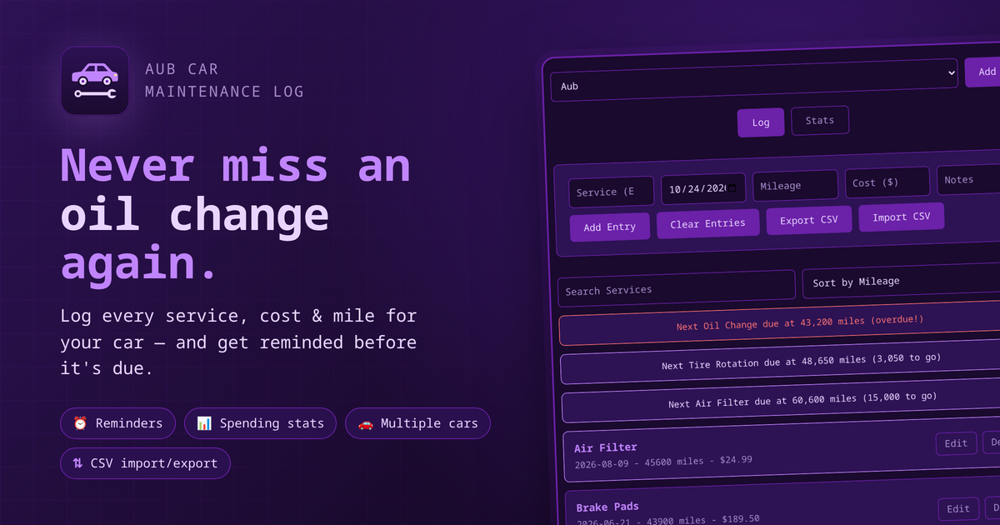
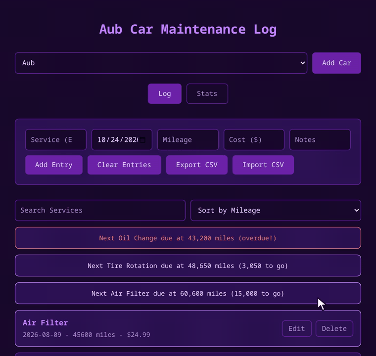

<p align="center">

</p>

<p align="center">

</p>

<h1 align="center">Aub Car Maintenance Log</h1>

<p align="center">
<b>Never miss an oil change again.</b><br>
Track every service, cost and mile for your car, saved locally in your browser.
</p>

<p align="center">
<a href="https://armd.one/Aub-Maintenance-Log/"></a>
</p>

<p align="center">


</p>

---

## Demo

<p align="center">

</p>

---

## About

Log each service with the date, mileage, cost and notes, and it stays saved between visits. Useful for remembering when you last changed the oil, rotated the tires, or dealt with anything else without digging through receipts.

It also keeps an eye on what's coming up next, and lets you know when something is overdue.

Everything is stored locally in your browser with `localStorage`, so there's no account and nothing leaves your machine.

---

## Features

| | Feature | What it does |
|---|---|---|
| ⏰ | **Service Reminders** | Shows when your next oil change, tire rotation or air filter is due, and turns red when it's overdue |
| 📊 | **Stats** | Total spent, average per service, cost per mile, spending by month and spending by service |
| 🚗 | **Multiple Cars** | Each car gets its own log, stats and reminders |
| 🔍 | **Search & Sort** | Find any service and sort by mileage, date or cost |
| ✏️ | **Edit & Delete** | Fix a mistake or remove an entry, with a confirm before deleting |
| 💡 | **Autocomplete** | Suggests service names you've used before |
| ⇅ | **CSV Export / Import** | Back up your log or move it to another device |
| 🔒 | **Private** | No account, no backend, your data never leaves your browser |

---

## Reminders

| Service | Every |
|---|---|
| Oil Change | 5,000 miles |
| Tire Rotation | 7,500 miles |
| Air Filter | 15,000 miles |

Want different intervals? Edit the `reminders` list in `index.js`.

---

## Usage

1. Pick your car (or click **Add Car** to add another one).
2. Type the service (e.g. Oil Change), pick a date, and enter the mileage, cost and any notes.
3. Click **Add Entry**.
4. Use **Edit** or **Delete** on any entry, and **Cancel** to stop editing.
5. Check the **Stats** tab to see where your money is going.
6. Click **Export CSV** to back up your log, and **Import CSV** to bring it back.

Try it live at [armd.one/Aub-Maintenance-Log](https://armd.one/Aub-Maintenance-Log/), or clone the repo and open `index.html` in your browser.

```bash
git clone https://github.com/aubergine-ux/Aub-Maintenance-Log.git
```

---

<p align="center">
Made with 💜 by <a href="https://github.com/aubergine-ux">aubergine-ux</a>
</p>
